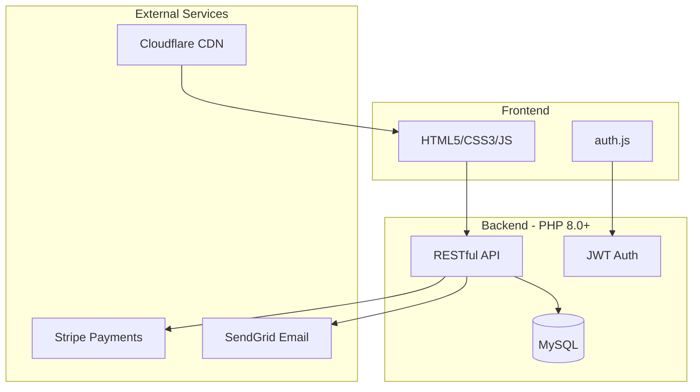
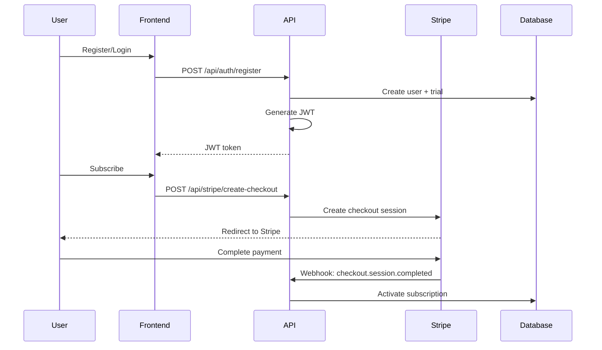

<div align="center">

# Bright Eyed Therapist

### Modern therapy tools built by a therapist who codes

[](https://brighteyedtherapist.com)
[](https://php.net)
[](https://stripe.com)
[](https://sendgrid.com)

*Affordable, accessible therapy tools for mental health professionals*

</div>

---

## The Story

As a therapist, I saw colleagues spending hundreds on clunky software that barely worked. As a developer, I knew I could do better. **Bright Eyed Therapist** is the result—a suite of modern, beautiful therapy tools at a fraction of the cost.

This isn't just a side project. It's a live SaaS platform with real users, real payments, and real impact.

---

## Features

| Tool | Description |
|------|-------------|
| **EMDR Therapy** | Interactive bilateral stimulation with customizable speed, color, and audio cues. Shareable sessions for remote therapy. |
| **Genogram Genie** | Visual family mapping with drag-and-drop nodes, relationship lines, and PDF export. |
| **Trauma Timeline** | Chronological visualization of life events with categorization and notes. |
| **Fear Facer** | Guided exposure therapy tool with anxiety tracking and progress monitoring. |
| **Guided Clarity** | AI-assisted introspection exercises for therapeutic journaling. |
| **Note Genie** | Clinical note templates with smart suggestions for session documentation. |

---

## Architecture



### Request Flow



---

## Tech Stack

<table>
<tr>
<td><strong>Frontend</strong></td>
<td>


</td>
</tr>
<tr>
<td><strong>Backend</strong></td>
<td>


</td>
</tr>
<tr>
<td><strong>Payments</strong></td>
<td>


</td>
</tr>
<tr>
<td><strong>Email</strong></td>
<td>


</td>
</tr>
<tr>
<td><strong>Infrastructure</strong></td>
<td>


</td>
</tr>
</table>

---

## Security

- **JWT Authentication** — Stateless, secure token-based auth with 30-day expiry
- **Email Verification** — Required for payments; soft-gated feature access
- **bcrypt Hashing** — Industry-standard password security
- **Stripe Webhook Signatures** — Cryptographic verification of all payment events
- **SQL Injection Protection** — PDO prepared statements throughout
- **Rate Limiting** — Brute force protection on auth endpoints
- **CORS Configuration** — Whitelisted origins only
- **Sensitive Files Protected** — `.htaccess` blocks direct access to config/logs
- **Admin Authorization** — Case-insensitive email whitelist via `Utils::isAdminEmail()`
- **Production Logging** — `console.log` wrapped in DEBUG flags (disabled in production)

---

## Quick Start

### Prerequisites

- PHP 8.0+ with PDO MySQL extension
- MySQL 5.7+ or MariaDB
- Composer
- Stripe account
- SendGrid account (optional, falls back to `mail()`)

### Installation

```bash
# Clone the repository
git clone https://github.com/shamanakin/BrightEyedTherapist.git
cd BrightEyedTherapist

# Install dependencies
composer install

# Configure credentials
cp api/config.local.php.example api/config.local.php
# Edit api/config.local.php with your credentials

# Import database schema
mysql -u your_user -p your_database < api/schema.sql

# Start local server
php -S localhost:8000
```

### Stripe Setup

1. Create products in [Stripe Dashboard](https://dashboard.stripe.com/products)
2. Add webhook endpoint: `https://yourdomain.com/api/stripe/webhook.php`
3. Subscribe to events: `checkout.session.completed`, `customer.subscription.*`, `invoice.*`
4. Copy signing secret to `config.local.php`

---

## API Reference

### Authentication
| Endpoint | Method | Description |
|----------|--------|-------------|
| `/api/auth/register.php` | POST | Create account + start trial |
| `/api/auth/login.php` | POST | Login, receive JWT + `isAdmin` flag |
| `/api/auth/me.php` | GET | Get current user (requires auth) |
| `/api/auth/verify-email.php` | GET | Verify email from link |
| `/api/auth/resend-verification.php` | POST | Resend verification email |
| `/api/auth/forgot-password.php` | POST | Request password reset email |
| `/api/auth/reset-password.php` | POST | Reset password with token |

### Payments
| Endpoint | Method | Description |
|----------|--------|-------------|
| `/api/stripe/create-checkout.php` | POST | Create Stripe checkout session |
| `/api/stripe/cancel-subscription.php` | POST | Cancel active subscription |
| `/api/stripe/webhook.php` | POST | Stripe webhook handler |

### Admin (Protected)
| Endpoint | Method | Description |
|----------|--------|-------------|
| `/api/admin/stats.php` | GET | Dashboard statistics |
| `/api/admin/users.php` | GET | User list with subscription status |
| `/api/admin/user.php` | GET | Single user details |
| `/api/admin/actions.php` | POST | Admin actions (verify, grant access, delete) |

---

## Admin Dashboard

The `/admin/` panel provides real-time insights:

- **User Growth** — Signups, trials, conversions
- **Revenue Tracking** — MRR, payment history
- **Subscription Management** — Extend trials, grant access, cancel subscriptions
- **User Verification** — Manual verify, resend emails

Admin access is controlled via email whitelist in `config.local.php`.

---

## Business Model

| Tier | Price | Features |
|------|-------|----------|
| **Free Trial** | 14 days | Full access to all tools |
| **Early Access** | $10/month | 6 core therapy tools |
| **VIP** *(planned)* | $20/month | All tools + priority support |

Special plans: **1-Year Promo** and **Lifetime Access** available via admin panel.

---

## Roadmap

- [x] Core platform with 6 therapy tools
- [x] Stripe subscription integration
- [x] Email verification system
- [x] Admin dashboard with user management
- [x] SendGrid transactional email
- [x] Password reset flow (forgot password → email → reset)
- [x] Admin panel navigation (account ↔ admin)
- [x] Case-insensitive admin authorization
- [x] Payment failure email notifications
- [ ] Mobile-responsive improvements
- [ ] Additional therapy tools
- [ ] Client portal for therapists
- [ ] Group practice features

---

## Screenshots

*Coming soon — live screenshots of the therapy tools and admin dashboard*

---

## Contributing

This is a personal portfolio project and live SaaS. Not accepting contributions, but feel free to use the architecture as inspiration for your own projects.

---

## License

Proprietary — All rights reserved

---

<div align="center">

**Built with care by a therapist who codes** *(or a coder who therapizes?)*

[Visit Live Site](https://brighteyedtherapist.com) · [Contact](mailto:matthew@brighteyedtherapist.com)

</div>
